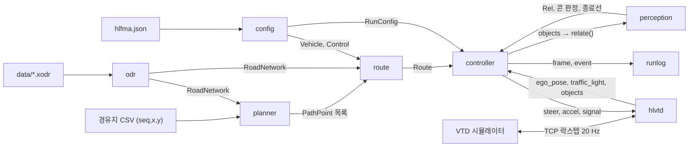
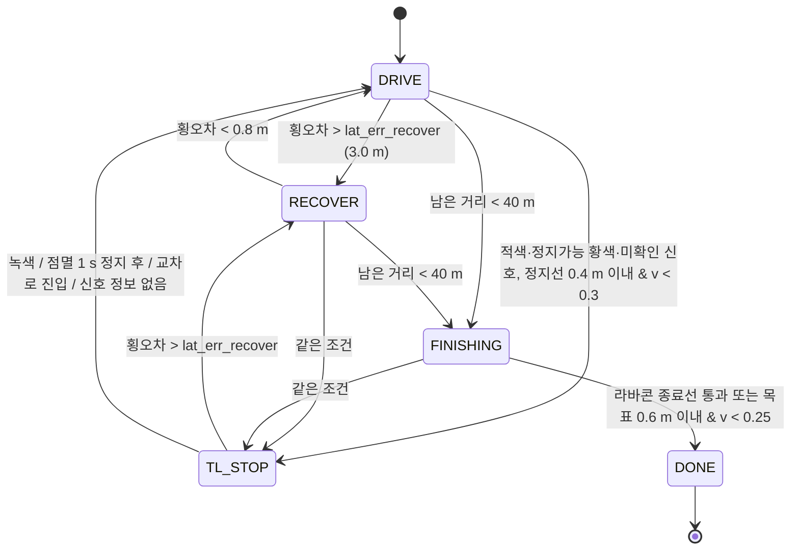

# IVH-VTD-controller

VTD(Virtual Test Drive) 시뮬레이터용 자율주행 제어기입니다.
TCP 락스텝으로 시뮬레이터와 20 Hz 로 주고받으며, OpenDRIVE HD 맵 위에서 경유지 CSV 를
차로 단위 주행 경로로 계획하고 순수추종 횡제어와 속도 프로파일로 주행합니다.

## Architecture

| 모듈 | 줄 수 | 역할 |
|---|---|---|
| `hlfma/odr.py` | 449 | OpenDRIVE 1.8 파서 — road, planView 기하(line/arc/poly3/paramPoly3), lane section, lane width, roadMark(실선/점선), elevation, junction |
| `hlfma/planner.py` | 690 | 경유지 → 차로 단위 경로. 힙 기반 탐색, 2 m 샘플링, 차선변경 블렌딩, 교차로 진입차로 보정(2-pass), 실선 횡단 회피, 주행가능성 검증 |
| `hlfma/controller.py` | 669 | 거동 상태기계 + 순수추종 횡제어(곡률 적응 lookahead), 종방향 속도 프로파일, 장애물 회피 오프셋, 신호등·정지선·보행자·선행차 대응, 정지 감시(3단계 에스컬레이션) 및 RECOVER |
| `hlfma/route.py` | 214 | 샘플링된 경로 + 지점별 속도 상한 (곡률 `v=√(a_lat/κ)`, 30 km/h 구간, 교차로, 종료) |
| `hlfma/hlvtd.py` | 184 | TCP 락스텝 클라이언트 — 제어 패킷 인코딩 / 데이터 패킷 디코딩, 재접속 |
| `hlfma/perception.py` | 125 | 크기·속도 기반 객체 분류(cone/ped/car), 상대좌표 투영, 차로 차단 콘 판정, 종료선 콘 라인 검출 |
| `hlfma/config.py` | 116 | 차량 제원(고정), 제어 상수 약 45개, JSON 오버라이드 가능한 `RunConfig` |
| `hlfma/runlog.py` | 67 | 실행별 로그 (`frames.csv`, `events.log`, `objects.jsonl`, `path.csv`, `meta.json`) |

시뮬레이터가 객체 타입을 주지 않기 때문에, 콘·보행자·차량 구분은 치수와 속도로 직접 분류합니다.
에고 속도도 제공되지 않아 위치 차분으로 유도합니다.

### 모듈 / 데이터 흐름

`run_controller.py` 의 실행 순서와 `hlfma` 패키지 내부 import 를 그대로 옮긴 그림입니다.



### 거동 상태기계 (`hlfma/controller.py`)



- 리스폰(한 스텝 5 m 초과 이동)은 상태와 무관하게 남은 거리 > 40 m 면 `DRIVE`, 아니면 `FINISHING` 으로 되돌립니다.
- 정지 감시(워치독 L1~L3)는 상태를 바꾸지 않고 `stuck_level` 로 제약만 단계적으로 풉니다.

## Run

```bash
python3 run_controller.py <route.csv> --host <VTD_PC_IP> [--cruise 8] [--plan-only]
```

- `--plan-only` — 접속 없이 경로 계획만 수행하고 종료
- 시작 시 에고 위치와 경로 시작점을 대조합니다. 50 m 초과면 경고만 하고(운행 중 조작 금지 규칙),
  1~50 m 면 실제 차량 위치에서 조용히 재계획합니다.
- 주행 중 연결이 끊기면 재접속해 이어가며, 그동안 `accel = -2.0` 을 유지합니다.

## Tests

```bash
python3 -m unittest discover -s tests -t .
```

31개 (`test_avoid` 9 · `test_cones` 8 · `test_controller_stop` 10 · `test_planner_routes` 4).

HD 맵과 경로 CSV 가 없으면 해당 테스트는 사유와 함께 **skip** 됩니다 (실패하지 않습니다).

| 테스트 | 필요한 외부 파일 |
|---|---|
| `test_cones` 8개 전부, `test_avoid` 의 `TestClassify`·`TestAvoidMargin` 7개 (**15개**) | 없음 — CI 에서 실행 |
| `test_avoid.TestBoundaryMark` 2개, `test_planner_routes.test_regress_curvature_1139` | `data/HL_FMA_VTD_LivingLab.xodr` (경로는 `tests/fixtures/` 에 포함) |
| `test_controller_stop` 10개 | 맵 + `../redmine/attachments/news29_route_pretest.csv` |
| `test_planner_routes` 나머지 3개 | 맵 + `../route_example.csv`, `../redmine/attachments/news29_route_pretest{,_2}.csv` |

전체를 돌리려면 주최측 제공 HD 맵을 `data/` 에, 경로 CSV 를 위 표의 경로(`../` 는 저장소 루트의 상위 폴더)에
두고 같은 명령을 실행합니다. 테스트 안의 파일 경로(`hlfma.json`, 맵, CSV)는 `__file__` 기준으로 잡으므로
작업 폴더에 영향받지 않습니다.

## Not in this repository

| 항목 | 제외 사유 |
|---|---|
| `data/*.xodr` (8.2 MB) | 대회 주최측이 제공한 HD 맵. 재배포 권리가 확인되지 않았습니다. |
| `DAYOF.md` | 운영 문서. 주최측 담당자 개인 연락처가 포함되어 있습니다. |
| `대회당일_운용카드.html` | 인쇄용 현장 운용 카드. 같은 연락처가 포함되어 있습니다. |
| `PROTOCOL.md` | 측정으로 역설계한 통신 규격서. 문서 일괄 제외 방침에 따릅니다. |
| `logs/`, `sweep_fail/` | 실행마다 재생성되는 산출물. |

제외된 파일은 전부 로컬 작업 폴더에 원본 그대로 남아 있습니다.

## Requirements

```
numpy>=1.24
```
